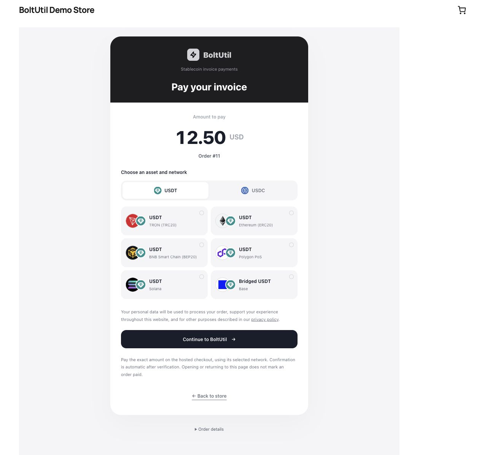
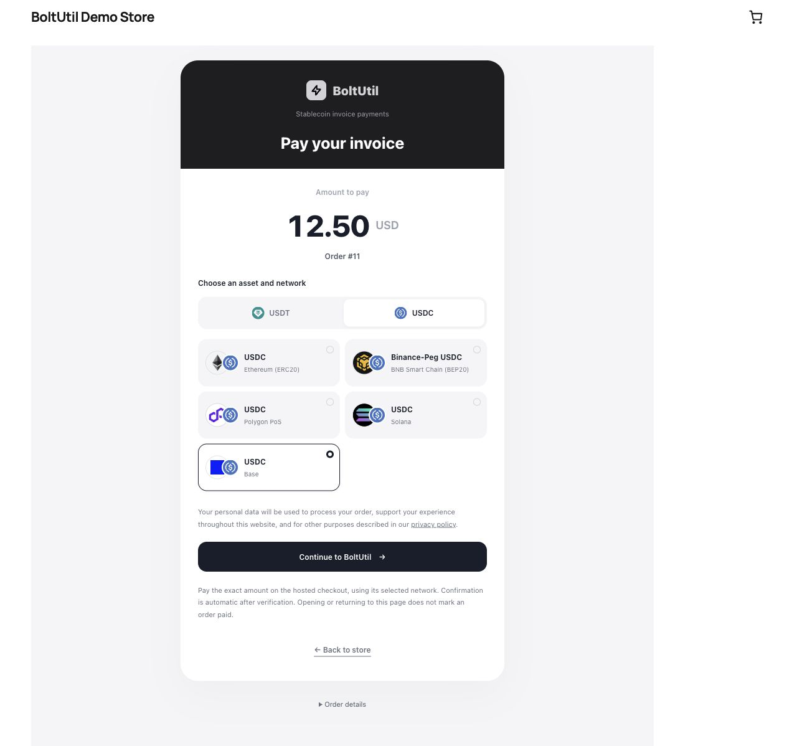
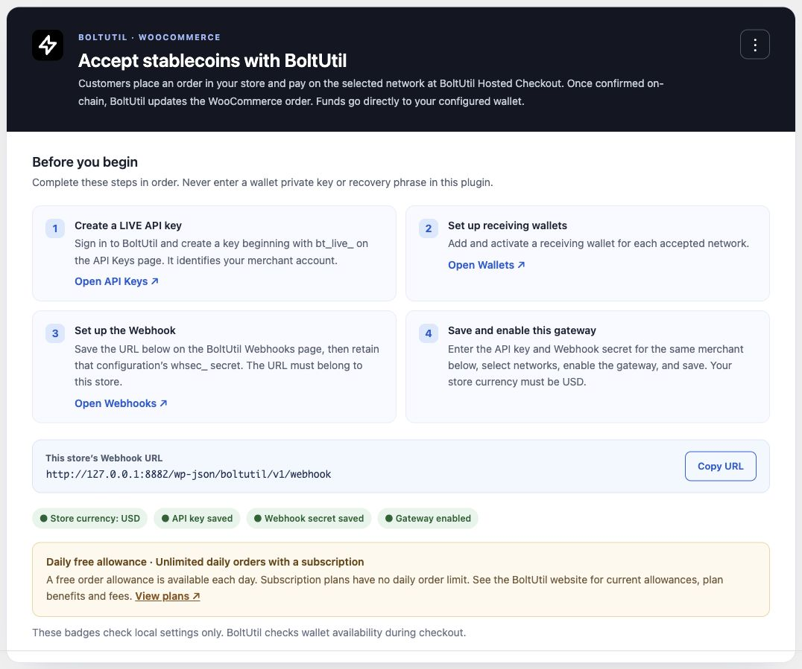
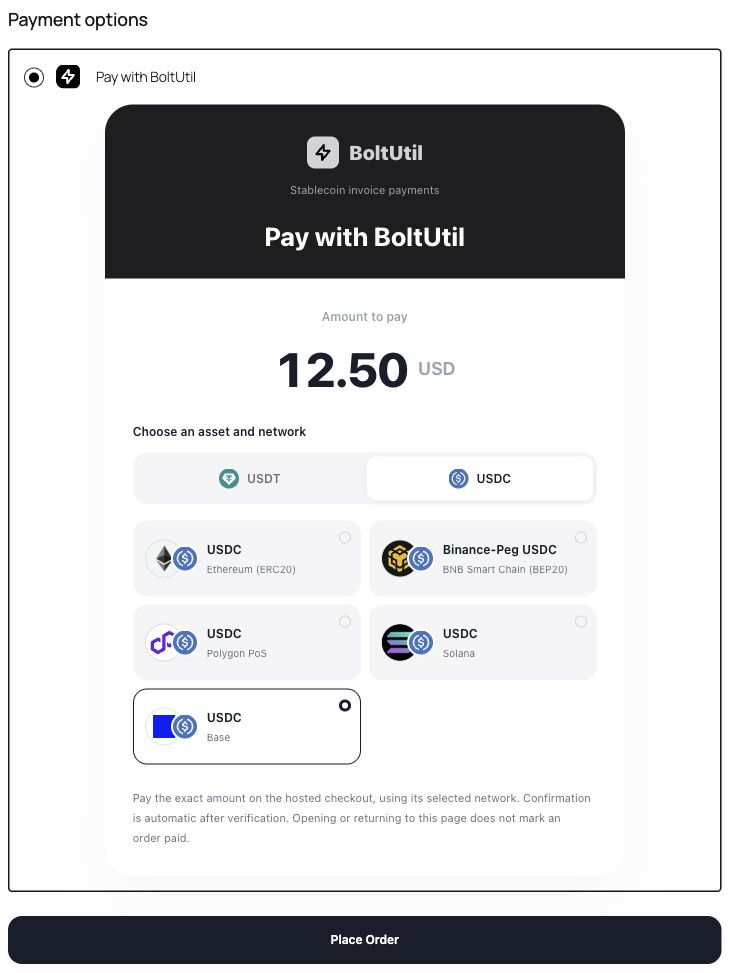
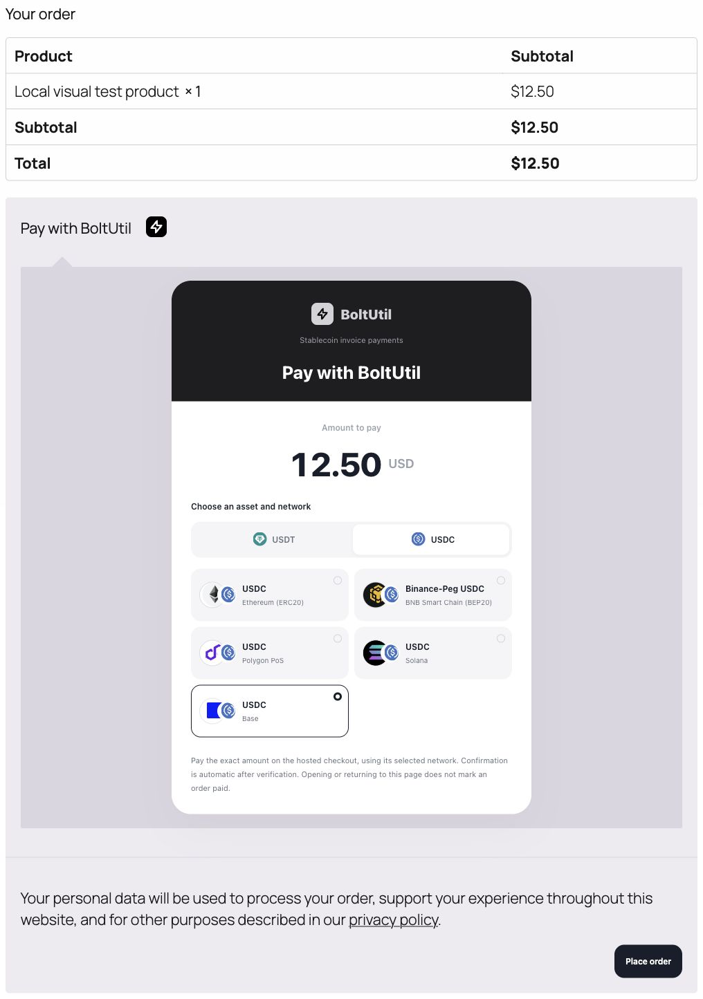
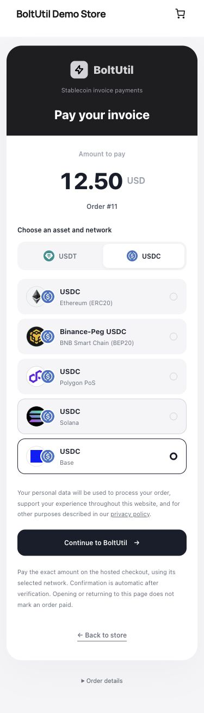

# BoltUtil Payments for WooCommerce

[English](README.md) · [简体中文](docs/i18n/README.zh-CN.md) · [Español](docs/i18n/README.es.md) · [Português](docs/i18n/README.pt-BR.md) · [Русский](docs/i18n/README.ru.md) · [Tiếng Việt](docs/i18n/README.vi.md) · [Türkçe](docs/i18n/README.tr.md) · [日本語](docs/i18n/README.ja.md) · [한국어](docs/i18n/README.ko.md) · [العربية](docs/i18n/README.ar.md) · [Français](docs/i18n/README.fr.md) · [हिन्दी](docs/i18n/README.hi.md)


**Accept USDT and USDC in your USD WooCommerce store.**

BoltUtil Payments for WooCommerce connects USD-denominated WooCommerce stores to BoltUtil Hosted Checkout. A BoltUtil merchant account is required.

Customers choose a stablecoin and an available network in WooCommerce, then continue to BoltUtil Hosted Checkout. On supported devices and networks, a connected wallet fills in the receiving address and exact amount; the customer reviews and confirms the transaction. Manual transfer remains available. Funds go directly to the merchant’s configured receiving wallet.

**Plugin v0.6.3** integrates with BoltUtil’s multi-asset Hosted Checkout. The plugin version and BoltUtil service version are separate.

[**Install from WordPress.org**](https://wordpress.org/plugins/boltutil-payments-for-woocommerce/) · [**Try the live demo**](https://shop-test.boltutil.com/?utm_source=github&utm_medium=referral&utm_campaign=woocommerce_plugin&utm_content=en_website) · [Integration guide](https://boltutil.com/woocommerce?utm_source=github&utm_medium=referral&utm_campaign=woocommerce_plugin&utm_content=en_woocommerce) · [Pricing](https://boltutil.com/pricing?utm_source=github&utm_medium=referral&utm_campaign=woocommerce_plugin&utm_content=en_pricing)

The demo shop sells small digital samples using **real funds**. Browsing is free; submitting a payment is a real transaction.

## Why BoltUtil

- **Consistent checkout:** matching BoltUtil invoice, Classic Checkout and Checkout Blocks cards, with USDT/USDC tabs and explicit network selection. Changing the asset clears the previous network choice.
- **Wallet confirmation or manual transfer:** payment methods are provided by BoltUtil Hosted Checkout. Quick-payment availability depends on the token, network, device and installed wallet.
- **Six networks, eleven supported combinations:** includes native USDC and explicitly labeled Bridged USDT on Base.
- **Verified order updates:** signed Webhooks plus a merchant-scoped API status check before completing a WooCommerce order. A browser return alone does not mark it paid.
- **Direct wallet settlement:** the plugin does not take custody or ask for wallet private keys or recovery phrases.
- **Language support:** GitHub ZIPs include English and eleven translations; WordPress.org installations use published WordPress language packs. [Language setup and translation maintenance](docs/I18N.md).
- **Daily free allowance:** subscription plans have no daily order limit. Current allowances, benefits and fees are defined on the [BoltUtil website](https://boltutil.com/pricing?utm_source=github&utm_medium=referral&utm_campaign=woocommerce_plugin&utm_content=en_pricing).

## See the checkout

The v0.6.3 payment cards share BoltUtil Hosted Checkout's layout, typography, controls and original network/token artwork.





Captured **2026-11-19** from a local WordPress installation running WooCommerce 11.1.0 and the v0.6.3 plugin. All products, invoices and merchant capabilities are synthetic; no production payment request or blockchain transfer was made. Store themes control the surrounding page. [Screenshot details](wordpress-org-assets/README.md).

<details>
<summary>Setup, Checkout Blocks, classic checkout and mobile invoice</summary>









</details>

Native WooCommerce billing, terms, order permissions and payment verification are preserved. When another payment method is available, customers retain WooCommerce's payment-method selection.

## Supported tokens and networks

| Network | USDT | USDC |
| --- | --- | --- |
| TRON (TRC20) | USDT | — |
| Ethereum (ERC20) | USDT | Native USDC |
| BNB Smart Chain (BEP20) | USDT | Binance-Peg USDC |
| Polygon PoS | USDT | Native USDC |
| Solana | USDT | Native USDC |
| Base | **Bridged USDT** | **Native USDC** |

Availability requires an enabled BoltUtil service route, the merchant’s active receiving wallet and the plugin’s allowed-token/network settings. Upgrades retain USDT-only defaults until the merchant enables USDC. The invoice identifies the exact token variant; another token with a similar name is not interchangeable.

## Install the plugin

1. **WordPress.org:** open **Plugins → Add New**, search for **BoltUtil Payments for WooCommerce**, then install and activate it. **Or use a GitHub release:** download [`boltutil-payments-for-woocommerce-0.6.3.zip`](https://github.com/boltutil/boltutil-payments-for-woocommerce/releases/download/v0.6.3/boltutil-payments-for-woocommerce-0.6.3.zip), optionally verify `SHA256SUMS.txt`, then use **Plugins → Add New → Upload Plugin**. GitHub's automatic source archives are not the install package.
2. Follow the five configuration steps below. Update the existing plugin in place; do not activate an older duplicate BoltUtil gateway folder.

**Requirements:** WordPress **7.0+**, PHP **7.4+**, WooCommerce **11.1+**, HTTPS and a WooCommerce store currency of **USD**. The plugin header declares WooCommerce 11.1 as its tested version. Classic Checkout, Checkout Blocks and HPOS are supported. Earlier WooCommerce versions are outside the declared support window.

BoltUtil is an external service. You need a LIVE `bt_live_` API key, a matching active Webhook and its `whsec_` secret, and receiving wallets configured in the same BoltUtil merchant account. Read the [service terms](https://boltutil.com/terms?utm_source=github&utm_medium=referral&utm_campaign=woocommerce_plugin&utm_content=en_terms) and [privacy policy](https://boltutil.com/privacy?utm_source=github&utm_medium=referral&utm_campaign=woocommerce_plugin&utm_content=en_privacy).

## Configure in five steps

1. Set **WooCommerce → Settings → General → Currency** to **USD**.
2. Create a LIVE key in [BoltUtil API Keys](https://boltutil.com/dashboard/api-keys?utm_source=github&utm_medium=referral&utm_campaign=woocommerce_plugin&utm_content=en_api-keys). Add and enable a receiving **address** for every intended network in [BoltUtil Wallets](https://boltutil.com/dashboard/wallets?utm_source=github&utm_medium=referral&utm_campaign=woocommerce_plugin&utm_content=en_wallets).
3. Open **WooCommerce → Settings → Payments → BoltUtil Payments** and copy the store-specific Webhook URL. Add it in [BoltUtil Webhooks](https://boltutil.com/dashboard/webhooks?utm_source=github&utm_medium=referral&utm_campaign=woocommerce_plugin&utm_content=en_webhooks) for the same merchant account as the API key; save its Webhook secret.
4. Enter the LIVE API key and Webhook secret, choose allowed stablecoins and networks, enable the gateway, and save. Saved credentials are masked. Blank credential fields on a later save preserve their stored values.
5. Check an unpaid test order and Hosted Checkout amount/address/expiry. Complete a small real payment → callback → paid order → download or fulfillment acceptance test before normal live sales.

The plugin calls only `https://api.boltutil.com` for its payment API. Wallets and blockchain monitoring remain in BoltUtil.

## Payment correctness

The USD numeric order total is used as a stablecoin invoice basis; this version does not quote or lock a live exchange rate. **Pay the exact token amount displayed on Hosted Checkout**, which can differ from the WooCommerce total. Network fees are separate. Invoice totals must be at least USD 1; unsupported amount formats and precision beyond six decimal places are rejected.

```text
WooCommerce checkout → BoltUtil Hosted Checkout
  → connected-wallet confirmation or exact manual transfer
  → on-chain confirmation → signed Webhook → merchant-scoped status check
  → WooCommerce order paid → normal WooCommerce fulfillment
```

Event deduplication, matching payment/order/token/network/amount, signature freshness and verified API status protect order completion. Manual and scheduled status rechecks are available. Underpaid, unusual or late transfers require merchant review; returning to the shop does not prove payment. An expired attempt requires a new WooCommerce order. Base uses L2 confirmation by default and confirms an order after the configured requirements are met. Strict mode waits for L1 finality. Timing depends on network and service conditions; no fixed confirmation time is guaranteed.

## Release and compatibility

The repository contains v0.6.3. GitHub Releases provides the installable ZIP; the [WordPress.org directory](https://wordpress.org/plugins/boltutil-payments-for-woocommerce/) provides its own language-pack edition. Check the directory version before installing. The public demo is maintained separately and is not proof that a particular plugin version is deployed.

- Classic Checkout and WooCommerce Checkout Blocks.
- WooCommerce High-Performance Order Storage (HPOS).
- Six networks and eleven USDT / USDC payment routes.
- English plus eleven bundled translations in the GitHub ZIP; WordPress.org installations use published language packs.
- Signed Webhooks, event deduplication and scheduled payment-status reconciliation.

## Common questions

**Can I use another store currency?** This release requires a USD WooCommerce store. It uses the numeric USD order total as the stablecoin invoice basis and does not quote a live exchange rate.

**Does installing the plugin make payments free?** The plugin is GPL software; BoltUtil is a separate hosted service with a daily free allowance and subscription plans. Check current pricing and network fees before going live.

**Does a wallet approval or browser return complete the order?** No. The plugin verifies the signed notification and merchant-scoped payment status before marking the WooCommerce order paid. A submitted transaction can still be waiting for on-chain confirmation.

## Support, development and license

Use [GitHub Issues](https://github.com/boltutil/boltutil-payments-for-woocommerce/issues) for plugin setup issues, and [support@boltutil.com](mailto:support@boltutil.com) for service/account/payment questions. Never post API keys, Webhook secrets, private keys or recovery phrases. Report vulnerabilities privately as described in [SECURITY.md](SECURITY.md).

See [CONTRIBUTING.md](CONTRIBUTING.md), [readme.txt](readme.txt), [translation guide](docs/I18N.md) and [release notes](.github/RELEASE_NOTES.md). Source is **GPLv2 or later**. See [LICENSE](LICENSE) and [asset licence notice](ASSETS-LICENSE.txt). Brand names identify supported integrations and do not imply endorsement.
