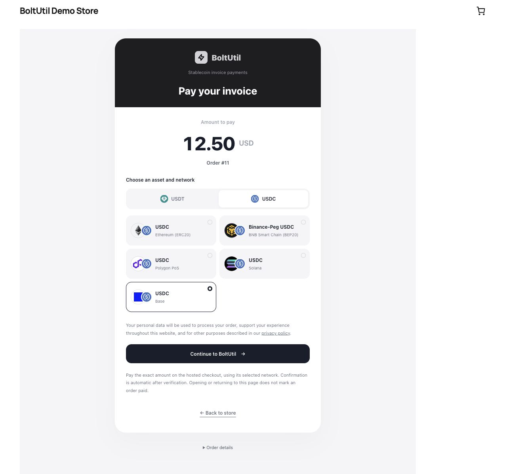
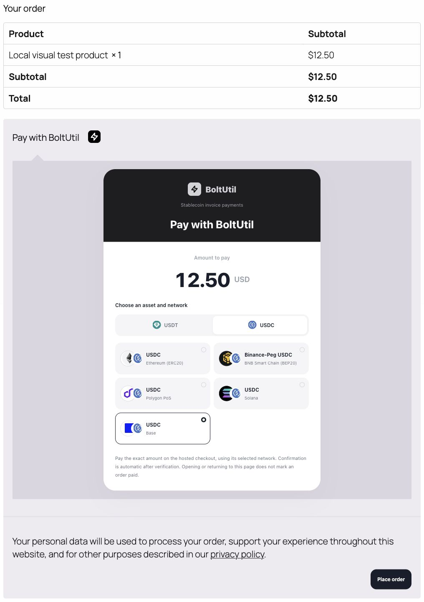
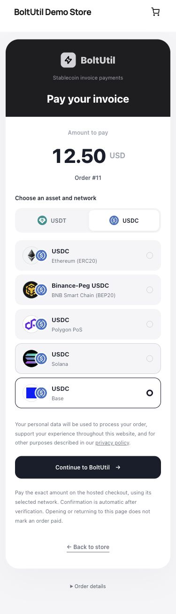

# BoltUtil — Acceptez USDT et USDC dans WooCommerce

[English](../../README.md) · [简体中文](README.zh-CN.md) · [Español](README.es.md) · [Português](README.pt-BR.md) · [Русский](README.ru.md) · [Tiếng Việt](README.vi.md) · [Türkçe](README.tr.md) · [日本語](README.ja.md) · [한국어](README.ko.md) · [العربية](README.ar.md) · [Français](README.fr.md) · [हिन्दी](README.hi.md)

Le plugin **v0.6.3** relie WooCommerce à BoltUtil Hosted Checkout. Le client choisit une monnaie et un réseau, puis paie le montant exact affiché. Sur les appareils et réseaux compatibles, le portefeuille connecté renseigne l’adresse et le montant pour vérification et confirmation. Le transfert manuel reste disponible. Les fonds arrivent directement dans le portefeuille du marchand.

Six réseaux : TRON, Ethereum, BNB Smart Chain, Polygon, Solana et Base. USDT est disponible sur six réseaux, USDC sur cinq, soit onze combinaisons. TRON prend uniquement en charge USDT ; Base utilise Bridged USDT et le USDC de BNB est Binance-Peg USDC. Seules les routes activées par le service, les portefeuilles du marchand et le plugin sont proposées.

## Installation et configuration

Téléchargez le ZIP installable v0.6.3 et importez-le depuis les extensions WordPress. Définissez la devise du magasin sur USD. Dans le même compte marchand BoltUtil, créez une LIVE API Key, configurez les portefeuilles et un Webhook actif, puis enregistrez les identifiants et réseaux dans le plugin. La mise à jour conserve commandes et identifiants ; USDC doit être activé séparément.

**WordPress 7.0+ · PHP 7.4+ · WooCommerce 11.1+ · HTTPS · USD**

## Langues et paiements

WordPress choisit la langue de l’interface. Les textes personnalisés du marchand ne sont pas traduits automatiquement. Un quota gratuit quotidien est disponible ; les abonnements n’imposent pas de limite quotidienne de commandes. Consultez les conditions et frais actuels sur le site. Payez le montant exact du checkout ; les frais réseau sont distincts. Le retour au magasin ne confirme pas le paiement : le plugin vérifie la signature et le statut.

La consultation de la démo est gratuite ; les petits achats utilisent des fonds réels. Publié dans le répertoire des extensions WordPress.org.

[Install from WordPress.org](https://wordpress.org/plugins/boltutil-payments-for-woocommerce/) · [GitHub ZIP](https://github.com/boltutil/boltutil-payments-for-woocommerce/releases/tag/v0.6.3) · [Live demo](https://shop-test.boltutil.com/?utm_source=github&utm_medium=referral&utm_campaign=woocommerce_plugin&utm_content=fr_website) · [Integration guide](https://boltutil.com/woocommerce?utm_source=github&utm_medium=referral&utm_campaign=woocommerce_plugin&utm_content=fr_woocommerce) · [Pricing](https://boltutil.com/pricing?utm_source=github&utm_medium=referral&utm_campaign=woocommerce_plugin&utm_content=fr_pricing)

[Full setup and payment contract](../../README.md#configure-in-five-steps) · [Language guide](../I18N.md) · [Security](../../SECURITY.md)

Le ZIP GitHub contient l’anglais et onze traductions. L’édition WordPress.org utilise les packs de langue publiés selon la langue sélectionnée ; les textes personnalisés du commerçant ne sont pas traduits automatiquement.

[WordPress.org](https://wordpress.org/plugins/boltutil-payments-for-woocommerce/)

## WooCommerce v0.6.3

Screenshots: 2026-11-19, local WordPress + WooCommerce 11.1.0 + plugin v0.6.3. Synthetic orders and merchant capabilities; no production payment or blockchain transfer. Store themes control the surrounding layout.
