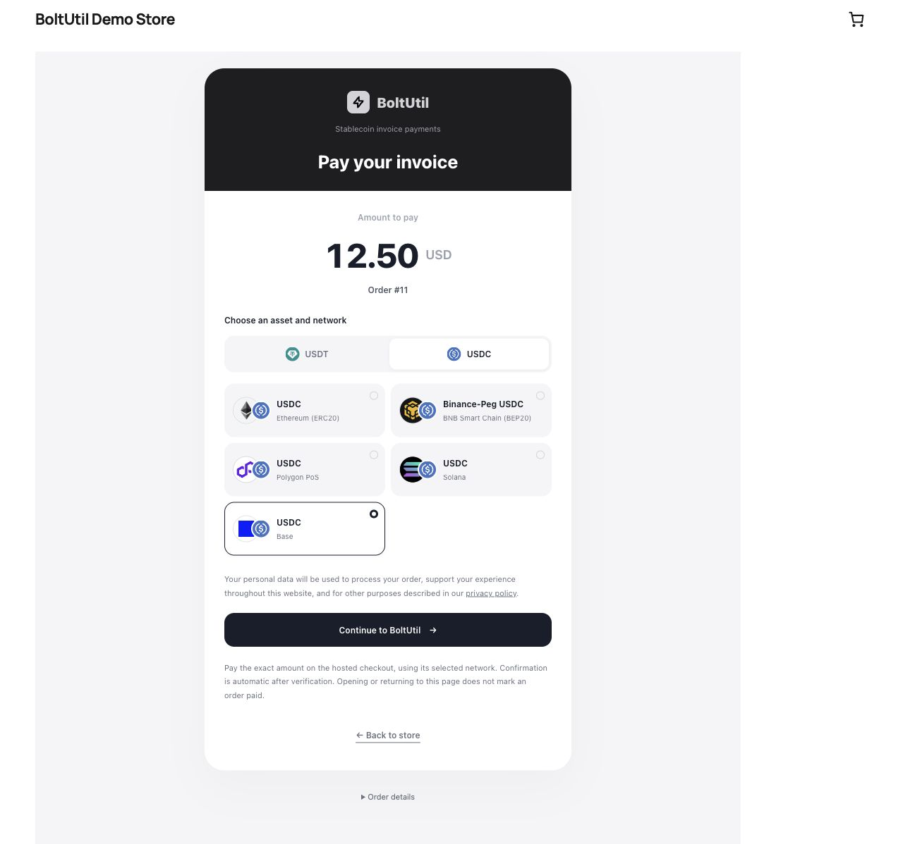
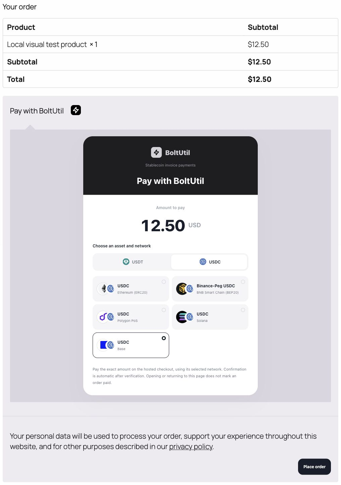
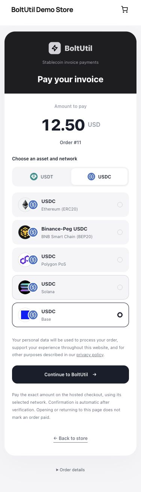

# BoltUtil — Receba USDT e USDC no WooCommerce

[English](../../README.md) · [简体中文](README.zh-CN.md) · [Español](README.es.md) · [Português](README.pt-BR.md) · [Русский](README.ru.md) · [Tiếng Việt](README.vi.md) · [Türkçe](README.tr.md) · [日本語](README.ja.md) · [한국어](README.ko.md) · [العربية](README.ar.md) · [Français](README.fr.md) · [हिन्दी](README.hi.md)

O plugin **v0.6.3** conecta o WooCommerce ao BoltUtil Hosted Checkout. O cliente escolhe a moeda e a rede e paga o valor exato exibido. Em dispositivos e redes compatíveis, a carteira conectada preenche o endereço e o valor para revisão e confirmação. A transferência manual também está disponível. Os fundos chegam à carteira configurada pelo lojista.

São seis redes: TRON, Ethereum, BNB Smart Chain, Polygon, Solana e Base. USDT em seis e USDC em cinco, totalizando onze combinações. TRON aceita apenas USDT; na Base o USDT é Bridged USDT e na BNB o USDC é Binance-Peg USDC. A disponibilidade depende do serviço, das carteiras do lojista e das opções do plugin.

## Instalação e configuração

Baixe o ZIP instalável da v0.6.3 e envie-o pela página de plugins do WordPress. Defina a moeda da loja como USD. Na mesma conta de lojista BoltUtil, crie uma chave API LIVE, configure as carteiras e um Webhook ativo; salve as credenciais e as redes no plugin. A atualização preserva pedidos e credenciais; o USDC precisa ser habilitado.

**WordPress 7.0+ · PHP 7.4+ · WooCommerce 11.1+ · HTTPS · USD**

## Idiomas e pagamentos

O WordPress define o idioma da interface. Textos personalizados do lojista não são traduzidos automaticamente. Há uma franquia gratuita diária, e as assinaturas não têm limite diário de pedidos; consulte os benefícios e custos atuais no site. Use o valor exato do checkout; as taxas de rede são separadas. Retornar à loja não comprova o pagamento: o plugin verifica a assinatura e o status antes de concluir o pedido.

A navegação na demo é gratuita; pequenas compras usam fundos reais. Disponível no diretório de plugins do WordPress.org.

[Install from WordPress.org](https://wordpress.org/plugins/boltutil-payments-for-woocommerce/) · [GitHub ZIP](https://github.com/boltutil/boltutil-payments-for-woocommerce/releases/tag/v0.6.3) · [Live demo](https://shop-test.boltutil.com/?utm_source=github&utm_medium=referral&utm_campaign=woocommerce_plugin&utm_content=pt-BR_website) · [Integration guide](https://boltutil.com/woocommerce?utm_source=github&utm_medium=referral&utm_campaign=woocommerce_plugin&utm_content=pt-BR_woocommerce) · [Pricing](https://boltutil.com/pricing?utm_source=github&utm_medium=referral&utm_campaign=woocommerce_plugin&utm_content=pt-BR_pricing)

[Full setup and payment contract](../../README.md#configure-in-five-steps) · [Language guide](../I18N.md) · [Security](../../SECURITY.md)

O ZIP do GitHub inclui inglês e onze traduções. A edição do WordPress.org usa os pacotes de idioma publicados para o idioma selecionado; os textos personalizados do comerciante não são traduzidos automaticamente.

[WordPress.org](https://wordpress.org/plugins/boltutil-payments-for-woocommerce/)

## WooCommerce v0.6.3

Screenshots: 2026-11-19, local WordPress + WooCommerce 11.1.0 + plugin v0.6.3. Synthetic orders and merchant capabilities; no production payment or blockchain transfer. Store themes control the surrounding layout.
