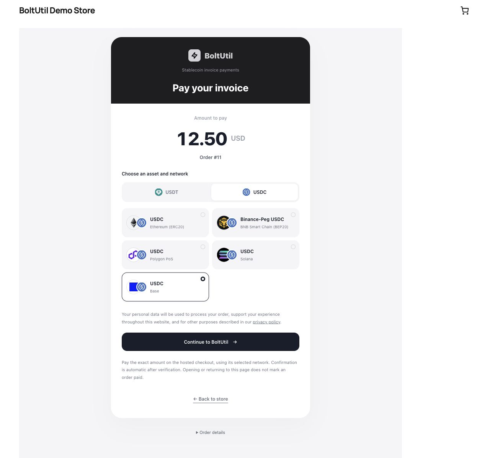
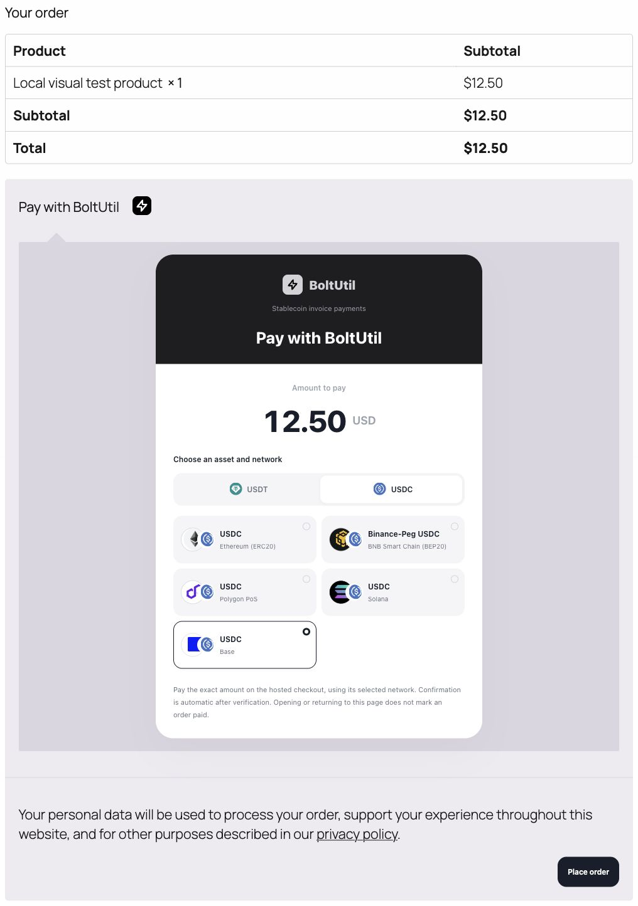
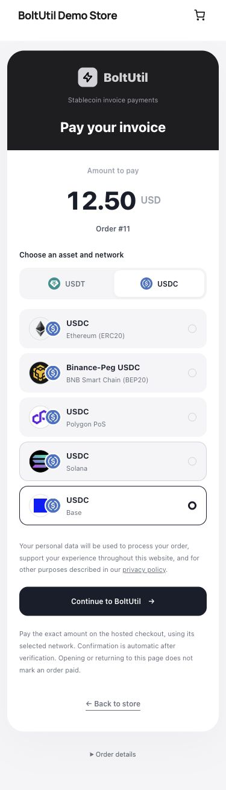

# BoltUtil — Принимайте USDT и USDC в WooCommerce

[English](../../README.md) · [简体中文](README.zh-CN.md) · [Español](README.es.md) · [Português](README.pt-BR.md) · [Русский](README.ru.md) · [Tiếng Việt](README.vi.md) · [Türkçe](README.tr.md) · [日本語](README.ja.md) · [한국어](README.ko.md) · [العربية](README.ar.md) · [Français](README.fr.md) · [हिन्दी](README.hi.md)

Плагин **v0.6.3** подключает WooCommerce к BoltUtil Hosted Checkout. Покупатель выбирает токен и сеть и оплачивает точную сумму. На поддерживаемых устройствах и сетях подключённый кошелёк заполняет адрес и сумму: покупатель проверяет их и подтверждает перевод. Доступен и ручной перевод. Средства поступают в кошелёк продавца.

Шесть сетей: TRON, Ethereum, BNB Smart Chain, Polygon, Solana и Base. USDT доступен в шести сетях, USDC — в пяти: всего одиннадцать сочетаний. TRON поддерживает только USDT. В Base используется Bridged USDT, а USDC в BNB — Binance-Peg USDC. Маршрут должен быть включён в сервисе, кошельках продавца и настройках плагина.

## Установка и настройка

Скачайте установочный ZIP v0.6.3 и загрузите через раздел плагинов WordPress. Валюта магазина — USD. В одном аккаунте продавца BoltUtil создайте LIVE API Key, настройте кошельки и активный Webhook, затем сохраните данные и сети в плагине. Обновление сохраняет заказы и ключи; USDC включается отдельно.

**WordPress 7.0+ · PHP 7.4+ · WooCommerce 11.1+ · HTTPS · USD**

## Языки и оплата

Язык интерфейса задаёт WordPress. Собственные тексты продавца автоматически не переводятся. Есть ежедневная бесплатная квота; подписки не ограничивают число заказов в день. Актуальные условия и стоимость указаны на сайте. Переводите точную сумму из checkout; комиссии сети оплачиваются отдельно. Возврат в магазин не подтверждает оплату: плагин проверяет подпись и статус платежа.

Просмотр демо бесплатен, покупки используют реальные средства. Опубликован в каталоге плагинов WordPress.org.

[Install from WordPress.org](https://wordpress.org/plugins/boltutil-payments-for-woocommerce/) · [GitHub ZIP](https://github.com/boltutil/boltutil-payments-for-woocommerce/releases/tag/v0.6.3) · [Live demo](https://shop-test.boltutil.com/?utm_source=github&utm_medium=referral&utm_campaign=woocommerce_plugin&utm_content=ru_website) · [Integration guide](https://boltutil.com/woocommerce?utm_source=github&utm_medium=referral&utm_campaign=woocommerce_plugin&utm_content=ru_woocommerce) · [Pricing](https://boltutil.com/pricing?utm_source=github&utm_medium=referral&utm_campaign=woocommerce_plugin&utm_content=ru_pricing)

[Full setup and payment contract](../../README.md#configure-in-five-steps) · [Language guide](../I18N.md) · [Security](../../SECURITY.md)

ZIP с GitHub содержит английский язык и одиннадцать переводов. Версия WordPress.org использует опубликованные языковые пакеты для выбранного языка WordPress; тексты продавца автоматически не переводятся.

[WordPress.org](https://wordpress.org/plugins/boltutil-payments-for-woocommerce/)

## WooCommerce v0.6.3

Screenshots: 2026-11-19, local WordPress + WooCommerce 11.1.0 + plugin v0.6.3. Synthetic orders and merchant capabilities; no production payment or blockchain transfer. Store themes control the surrounding layout.
